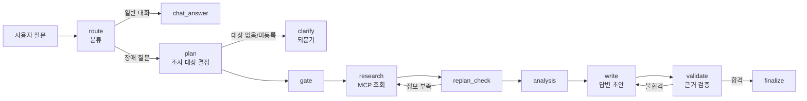

# 운영 장애 대응 AI Agent

운영 장애 질문(예: "payments-service 응답이 느려지고 CPU가 치솟았어요")을 받으면 모니터링 데이터를 조회하고, 장애 유형에 맞는 런북(대응 절차)을 찾아 답을 만들어 주는 에이전트 서비스입니다. 제공된 Base AI Agent(`all_total_vue_student`)를 출발점으로, 모델이 지어내거나 잘못 고르던 부분을 코드로 보정하고 구조·테스트·화면을 개선했습니다.

- 백엔드: FastAPI, LangGraph(상태 그래프), MCP(모니터링 조회·런북), SSE 스트리밍
- LLM 백엔드: `fake`(테스트용) / `ollama`(로컬) / `openai`(원격 API) 중 환경변수로 선택
- 추적: LangSmith
- 화면: Vue 3(CDN) 단일 파일 `web_chat.html`

## 어떻게 동작하나



- `server.py`가 `/chat`, `/chat/stream`(SSE), `/health`, `/version`을 제공합니다.
- MCP 서버(`mcp_server.py`)는 모니터링 조회 도구(`get_monitoring_status`), 런북 리소스(`runbook://incident-response/{type}`), 분석 프롬프트를 제공합니다. 데이터는 `data/monitoring.json`(시스템 6개)과 `data/runbooks/`(런북 6개)입니다.
- 의존성(모델, MCP 클라이언트, 시스템 목록)은 `agent/deps.py`로 주입해서, 테스트에서 가짜 모델로 바꿔 끼울 수 있습니다.

## 바꾼 것과 이유

개선의 기준은 하나입니다. **코드가 확인할 수 있는 사실은 모델에게 맡기지 않고 코드가 먼저 정한다.**

### 정확성

| 문제 | 변경 | 파일 |
|---|---|---|
| 소형 모델이 운영 질문을 일반 대화로 분류해, 조회 없이 답을 지어냄 | 시스템 이름과 운영 키워드가 있으면 코드가 장애 질문으로 보정. 시스템을 되물은 직후에 이름만 답해도 이어받음 | `agent/routing.py` |
| 미등록 시스템을 auth-service로 바꿔 조사, 시스템을 말하지 않으면 auth-service로 가정, 여러 시스템을 물어도 하나만 조사, 후속 질문("그 시스템")에서 이전 대화를 무시 | 조사 대상을 코드가 먼저 결정: 질문에 나온 등록 시스템은 전부 조사, 미등록은 조회 불가로 안내, 지정이 없으면 되묻기, 후속 질문은 이전 대화의 시스템 사용 | `agent/targets.py` |
| 증상 근거가 없어도 `db-down` 런북으로 폴백 | 근거가 없으면 런북을 고르지 않음(조회 생략) | `agent/incident_rules.py` |
| 답변 검증이 글자 수·번호 형식만 확인 | 수치, 시스템 이름, 조사 누락, 근거 없는 원인 서술(배포·트래픽 등)을 수집 데이터와 대조. 불합격이면 다시 쓰고, 끝까지 실패하면 경고를 붙여 반환 | `agent/verifier.py` |

- 되묻기 뒤 등록 시스템 이름만 답하면, 처음 말한 증상을 이어받아 계획과 답변에 사용합니다(`agent/routing.py`, `agent/nodes/routing_nodes.py`).

### 안정성·성능

| 문제 | 변경 | 파일 |
|---|---|---|
| 조사 작업 하나가 실패하면 요청 전체가 실패, MCP 호출에 시간 제한 없음 | 실패한 작업만 `failed`로 표시하고 나머지로 진행, MCP 호출 제한시간 추가 | `agent/nodes/research_nodes.py` |
| 동기 LLM 호출이 이벤트 루프를 막음, Ollama 사고 토큰·출력 길이 제한 없음 | `asyncio.to_thread`로 분리, Ollama에 timeout·`think: false`·출력 길이 제한 설정 | `agent/nodes/*`, `agent/ollama_llm.py`, `agent/openai_llm.py` |
| 대상이 1개뿐이어도 분석 LLM을 호출 | 비교 대상이 2개 이상일 때만 분석 단계 실행 | `agent/routing.py` |
| 스트림 중 오류가 나면 연결만 끊김, 빈 입력·긴 입력도 그래프까지 전달 | `Error` 이벤트로 전달, 빈 입력과 2000자 초과는 422로 거절, 노드별 실행 시간을 로그·응답 metadata에 기록 | `server.py`, `agent/timing.py` |

### 구조·테스트

- 345줄이던 `graph.py`를 `state.py`, `streaming.py`, `timing.py`, `nodes/`로 분리해 76줄로 줄였습니다(동작 변경 없음). 시스템 목록 로더 중복도 하나로 합쳤습니다.
- 모델 없이 도는 pytest 77개(가짜 모델·가짜 MCP 주입, LangSmith 전송 차단).
- `eval/target_accuracy.py`: 질문 34건으로 "조사 대상이 질문과 같은가"를 개선 전/후 규칙으로 비교합니다. 모델과 네트워크가 필요 없습니다.

### 화면 (`web_chat.html`)

- 대화 목록(여러 대화, 브라우저 `localStorage`에 저장), 단계별 진행 표시와 걸린 시간, 총 소요 시간, 응답 중단 버튼
- 완료된 진행 단계는 접어서 답변을 먼저 보여주고, 조회 실패가 있으면 진행 요약과 해당 단계에 표시
- 검수에서 반려된 초안은 접어서 표시하고, 통과한 답만 최종 답변으로 보여줌
- 서버를 바꾸지 않는 클라이언트 변경이며, 중단은 화면의 연결만 닫습니다(서버의 모델 호출은 끝까지 돌 수 있음)

## 측정 결과

로컬 Ollama(qwen3), 질문당 1회 측정. 같은 입력으로 개선 전 코드와 비교했습니다.

| 입력 | 개선 전 | 개선 후 |
|---|---|---|
| `billing-service` 응답 지연(미등록 시스템) | 42.1s, auth-service로 대체해 조사 | 2.6s, 미등록 안내 |
| "로그인이 너무 느려요"(시스템 미언급) | 43.9s, auth-service로 가정 | 0.9s, 어느 시스템인지 되묻기 |
| `web-01 상태 진단해줘` | 2.0s, 조회 없이 답함 | 14.7s, 실제 조회 후 답함 |
| `eval/target_accuracy.py` 34건 | 17/34 (50%) | 31/34 (91%) |

- 조회와 검수 단계가 늘어난 질문은 오히려 느려졌습니다(위의 `web-01` 등). 정확성과 맞바꾼 시간입니다.
- 정확도는 모델 호출 없이 규칙만 비교한 값입니다. 평범한 질문(등록 시스템 언급)은 전후가 같고, 미등록·미언급·후속 질문에서 차이가 납니다. 개선 전 값은 원본 규칙을 옮겨 모델이 이상적으로 답한다고 가정한 시뮬레이션입니다.
- 같은 장애 질문을 로컬 모델과 OpenAI로 돌렸을 때 1분 8초와 6초였습니다. 시간 대부분이 답변 작성 단계의 모델 추론이라, 코드 개선보다 모델 선택의 영향이 큽니다.
- 상세 기록: `final-report/`(단계별 문서), `work-log/`

## 한계

- 라우팅·장애 유형 판단은 키워드 규칙이라 규칙 밖 표현은 놓칩니다. 한글 별칭("인증 서비스"), 오타(`payment-service`), 대문자(`WEB-01`)를 시스템 이름으로 인식하지 못합니다.
- 처음 질문에 시스템명이 없고 되묻기에 등록 시스템 이름만 답한 경우에만 원래 증상을 이어받습니다. 미등록 시스템에서 다른 시스템으로 바꾸거나 새 증상을 적은 경우에는 합치지 않습니다.
- 검증기도 규칙 기반이라 놓치는 표현이 있고, 재작성이 일어나면 30~35초가 더 걸립니다.
- 로컬 모델에서는 답변 작성이 전체 시간의 대부분입니다(LangSmith 기준 43.8s 중 38.2s). 코드로 줄이지 못했습니다.
- 비용 값은 글자 수 기반 추정치이고, `retry` 횟수는 첫 도구 호출을 일부러 한 번 실패시키는 시뮬레이션입니다.
- 측정은 질문당 1회라 통계적 수치가 아닙니다. 실제 모델에서 검증기가 개입한 경우는 1건만 관찰했습니다.
- RAG는 쓰지 않았습니다. 런북이 6개(약 3.7KB)라 장애 유형 이름으로 바로 조회합니다.

## 실행 방법

```bash
bash sh/setup_venv.sh                 # .venv 생성 + 의존성 설치 (최초 1회)
cp .env.example .env                  # 키를 채운다 (.env는 커밋하지 않음)
bash sh/setup_ollama.sh               # 로컬 모델 준비 (Ollama 사용 시)

bash sh/run_agent_ollma.sh            # 에이전트 서버 (로컬 모델, :8100)
# 또는 bash sh/run_agent_openai.sh    # OpenAI API 사용 (과금됨, .env에 OPENAI_API_KEY 필요)

bash sh/run_frontend.sh               # 채팅 화면 http://localhost:8600 (서버 기동 후)
```

```bash
source .venv/bin/activate
python -m pytest -q                   # 단위 테스트 (모델·네트워크 불필요)
python eval/target_accuracy.py        # 조사 대상 결정 정확도 평가
python ask.py "payments-service CPU 급증 원인 확인해줘"   # 터미널에서 한 건 질의
```

주의: `run_agent_*.sh`는 시작할 때 이전 대화 기록(`session.db`)을 지우고 8100 포트를 쓰던 프로세스를 종료합니다.

## 폴더 구조

```
server.py               FastAPI 서버 (/chat, /chat/stream, /health, /version)
web_demo_server.py      브라우저 화면용 프록시 (:8600)
web_chat.html           Vue 3 채팅 화면
mcp_server.py           MCP 서버: 모니터링 조회 도구, 런북 리소스
agent/
  graph.py              그래프 배선(노드 연결과 분기)
  state.py streaming.py timing.py
  nodes/                routing_nodes · research_nodes · answer_nodes
  routing.py            라우팅 보정, 분석 단계 실행 여부 결정
  targets.py            조사 대상 결정
  incident_rules.py     장애 유형(런북) 선택 규칙
  verifier.py           답변 근거 검증
  deps.py               의존성 주입(모델·MCP·시스템 목록)
  fake_llm.py ollama_llm.py openai_llm.py   LLM 백엔드
  mcp_client.py retry.py session_store.py
data/                   monitoring.json, runbooks/
tests/                  pytest 77개
eval/                   target_accuracy.py
sh/                     환경 준비·실행 스크립트
doc/                    Base 프로젝트 설명서, 사용 매뉴얼
final-report/           단계별 개선 문서(문제 → 변경 → 전후 코드 → 확인 방법)
work-log/ study-log/    작업 기록, 학습 기록
```
